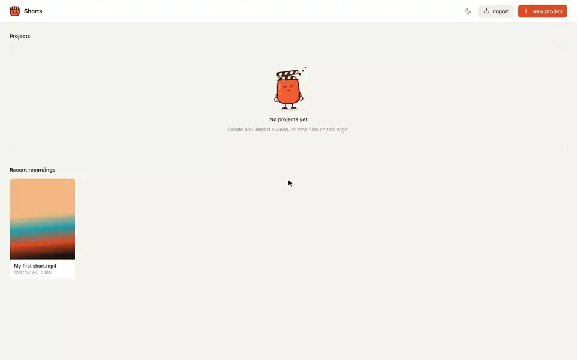
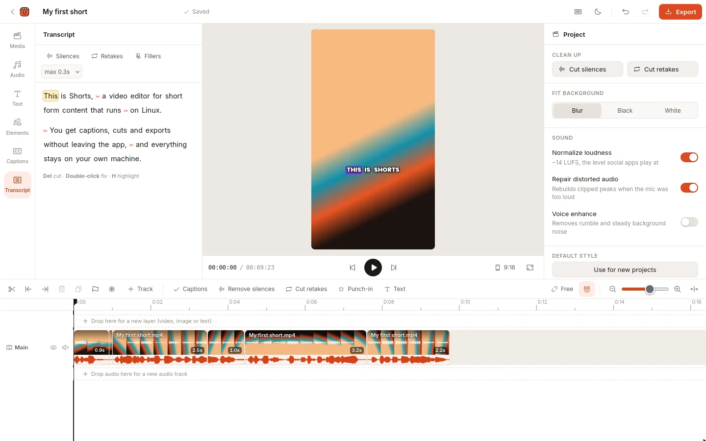
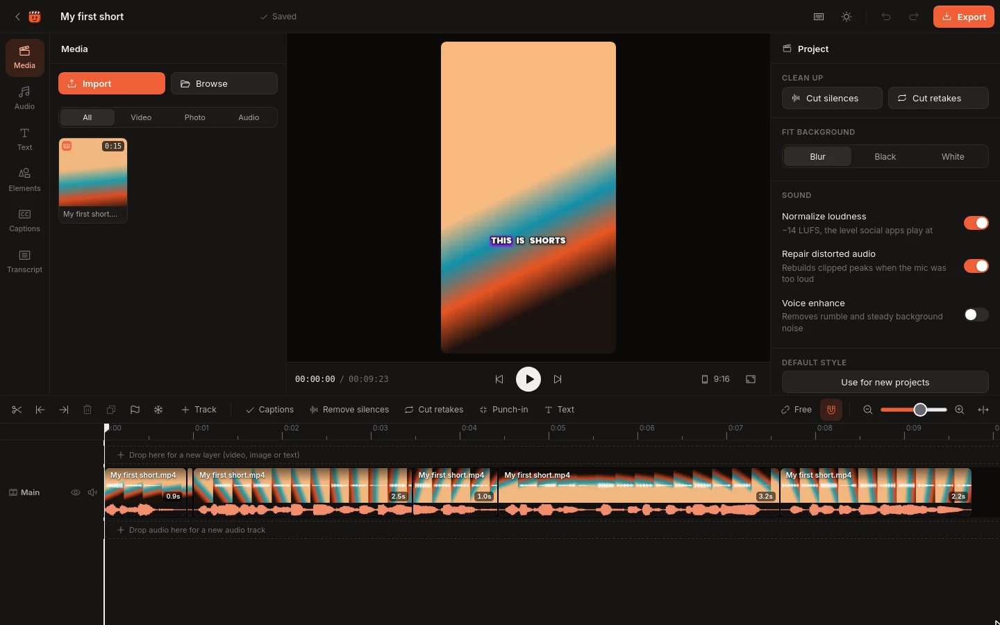

<div align="center">


# Shorts

**The CapCut-style editor for short-form video. Free, open source, and it runs entirely on your machine.**

Auto captions · edit by deleting words · one-click silence and retake removal · export ready for Reels, TikTok and Shorts

[](https://github.com/MarioRodrigues10/shorts/actions/workflows/ci.yml)
[](LICENSE)


[Install](#install) · [Features](#features) · [Why](#why-i-built-it) · [FAQ](#faq)

<br>



<sub>Real recording, with the transcription and export waits sped up. <a href="docs/media/demo.mp4">MP4 version</a>. The clip is synthetic, so no personal footage ships with this repo.</sub>

</div>

## From raw recording to posted in about two minutes

1. **Drop in your video.** Phone footage, screen recordings, anything ffmpeg reads.
2. **Click _Auto captions_.** Whisper transcribes only what's on your timeline, on your own CPU.
3. **Click _Cut retakes_ and _Remove silences_.** False starts and dead air are gone.
4. **Pick a caption style.** Word-by-word highlights, boxes, karaoke, one word at a time. Drag it where you want.
5. **Delete words in the transcript** to cut them from the video, like editing a doc.
6. **Export.** 1080×1920 H.264 at −14 LUFS, plus `.srt` captions and a `.txt` transcript for your post.

## Why I built it

I make short-form videos for **[IdealJob](https://idealjob.app)**, and Shorts is the editor I built to edit them. Before, I used CapCut or DaVinci Resolve. On Linux neither works well:

- **CapCut** has no Linux version.
- **DaVinci Resolve** runs on Linux, but the experience is miserable for short-form content:
  - The free version can't read H.264 or AAC on Linux, so every phone or screen recording had to be converted to DNxHR before I could import it.
  - Captions meant exporting the audio and running a separate transcription tool in the terminal.
  - Every export needed another pass through ffmpeg before Instagram or TikTok would accept it.
  - Caption styling was very limited.

So I built my own: the editing flow I liked in CapCut, running natively on Linux (and now macOS and Windows), with everything, transcription included, on my own machine.

### How it compares

| | **Shorts** | CapCut | DaVinci Resolve (free) |
|---|:---:|:---:|:---:|
| Runs on Linux | ✅ | ❌ | ✅ |
| Opens phone footage (H.264/AAC) on Linux | ✅ | — | ❌ |
| Auto captions | ✅ on your CPU | ✅ | ❌ Studio only |
| Edit the video by editing the transcript | ✅ | ✅ | ❌ Studio only |
| Open source | ✅ MIT | ❌ | ❌ |
| Price | Free | Free + Pro subscription | Free / Studio $295 |

## Features

<table>
<tr>
<td width="50%"></td>
<td width="50%"></td>
</tr>
</table>

**Speech editing**
- **Auto captions** transcribe only the parts of your videos that are on the timeline, and only the new parts after you edit.
- **Transcript editing:** delete words to cut them, fix misheard words, highlight words for captions.
- One-click **Remove silences**, **Cut retakes** (false starts), **Cut fillers** (um, uh) and **Punch-in** (alternating zoom on cuts).

**Captions and graphics**
- 7 caption styles (word highlight, box, one word, karaoke…) with full control over font, colors, outline, shadow and animation. Drag them on the canvas.
- Text presets, emoji stickers, and highlight shapes (boxes, circles, arrows, underlines).

**Timeline**
- A main track plus as many video, image, text and audio rows as you need. Free placement or a magnetic main track.
- Trim, split, delete left/right of the playhead, duplicate, copy/paste, markers, snapping. Zoom stays anchored on the playhead.
- Transitions (dissolve, dips, slides, wipes, zoom, circle) and keyframes for position, scale, rotation and opacity.
- Speed, flip, freeze frame, detach audio, slow zoom (Ken Burns), intro effects.
- **Smooth cuts**: hides jump cuts by lining your face up across the cut, then gliding back to the normal framing.

**Look and sound**
- Color looks and adjustments: brightness, contrast, saturation, temperature, sharpen, denoise.
- **Auto reframe** follows your face to turn landscape footage into 9:16. **Background replacement** with blur or a color.
- Music and sound effects that duck under your voice automatically, plus voiceover recording.
- Loudness normalization to −14 LUFS, voice enhance, automatic repair of clipped (distorted) audio, and **Lower breaths**, which makes breathing between sentences almost silent without changing your timing.

**Export**
- 30 or 60 fps, 1080p or 720p, H.264 + AAC. Uses the Intel GPU encoder (VA-API) on Linux when available, x264 otherwise.
- No generational loss: each clip is rendered losslessly once and cached; only the final encode compresses.

## Install

You need **git**. The setup script tells you exactly what else to install (FFmpeg, [uv](https://github.com/astral-sh/uv) and [Bun](https://bun.sh)) if anything is missing.

**Linux and macOS**

```sh
git clone https://github.com/MarioRodrigues10/shorts.git
cd shorts
scripts/setup.sh
```

On macOS, get the requirements with [Homebrew](https://brew.sh): `brew install ffmpeg uv oven-sh/bun/bun`.

**Windows 10 / 11** (PowerShell)

```powershell
git clone https://github.com/MarioRodrigues10/shorts.git
cd shorts
powershell -ExecutionPolicy Bypass -File scripts\setup.ps1
```

On Windows, missing tools are installed for you with `winget`.

The setup script:
- creates the Python environments
- downloads the caption fonts and vision models (all openly licensed)
- builds the UI
- installs the `shorts` command, plus a background service on Linux, `~/Applications/Shorts.command` on macOS, or a Start Menu shortcut on Windows

The Whisper model (about 500 MB) downloads on your first transcription. Add `--no-vision` (`-NoVision` on Windows) to skip auto reframe and background replacement and save about 400 MB.

## Use

```sh
shorts                    # open the app in your browser
shorts path/to/clip.mp4   # start a project from a clip
shorts convert file.mov   # platform-ready MP4, no editing
```

Press `?` in the editor for every shortcut. The essentials:

| Key | Action | Key | Action |
|---|---|---|---|
| `Space` | Play / pause | `S` | Split |
| `Q` / `W` | Delete left / right of playhead | `Del` | Delete |
| `←` `→` | Frame step (Shift: 1 s) | `↑` `↓` | Previous / next cut |
| `T` | Add text | `Ctrl+Z` / `Y` | Undo / redo |
| `Ctrl+E` | Export | `?` | All shortcuts |

**Coming from DaVinci Resolve?** Copy `integrations/resolve/Send to Shorts.py` into `~/.local/share/DaVinciResolve/Fusion/Scripts/Utility/`. Then *Workspace → Scripts → Send to Shorts* renders the current timeline and opens it here for captions and export.

## Meet Shorty

<p align="center">


</p>

Shorty keeps you company in the app: listening while it transcribes, celebrating when your video is ready, and napping when there's nothing to edit yet. It's a clapperboard with scissors, because editing is mostly cutting. Every pose is plain SVG generated by [`docs/mascot/build.py`](docs/mascot/build.py).

## Your data stays yours

Transcription, rendering and the editor all run on your computer. No accounts, no uploads, no API keys, no telemetry.

| What | Where |
|---|---|
| Settings | `~/.config/shorts-studio/config.json` |
| Projects, transcripts, proxies, render cache | `~/.local/share/shorts-studio/` |
| Imported files | `~/Videos/Shorts/Media` (configurable) |
| Exports | `~/Videos/Shorts/Exports` (configurable) |

`config.json` lets you change:
- the folders shown in the media browser (`library_dirs`)
- `upload_dir` and `export_dir`
- the Whisper `model` and `language`
- `vocabulary` (names Whisper should know)
- encoder settings

## FAQ

**Does it work in my language?**
Yes. Set `"model": "small"` (multilingual) and your `"language"` (for example `"pt"` or `"es"`) in `config.json`. The default `small.en` is the most accurate choice for English.

**Do I need a GPU?**
No. Everything runs on the CPU, and it was built on an 8 GB laptop. Previews use lightweight proxies, heavy jobs run one at a time at low priority, and on Linux the service is memory-capped. Intel GPUs speed up exports on Linux.

**Is it really offline?**
After setup, yes. The only downloads are the Whisper model on first use and the models and fonts during setup.

**Which platforms are tested?**
Linux is the daily driver. CI runs the setup scripts and an export on Linux, macOS and Windows on every push. Bug reports from macOS and Windows are very welcome.

## How it works

```
web/            React + Tailwind + Radix UI, built into static/app
  src/core/     the editing engine: project model, timeline, preview player,
                caption/text renderer, keyframes (plain JS)
server.py       stdlib HTTP server on 127.0.0.1: media registry, background worker
                (proxies, filmstrips, waveforms, transcripts), projects, export via ffmpeg
transcribe.py   faster-whisper on CPU + energy-based word boundary refinement
vision.py       MediaPipe face tracking and person segmentation (CPU)
```

- **Preview and export match.** The same JavaScript draws captions and text in the preview and in the export. The browser renders the caption layer and the server composites it.
- **No drift across hundreds of cuts.** Each clip is rendered to a lossless cached piece on a single frame grid. Transitions are separate pieces. The final pass adds overlays, the caption layer and the audio mix (ducking, two-pass loudness), then encodes once.

## Contributing

Issues and pull requests are welcome. See [CONTRIBUTING.md](CONTRIBUTING.md) for the dev setup, how to test without touching your own projects, and how the repo keeps personal data out of git. `scripts/demo/record.sh` re-records the demo above from a synthetic clip.

If Shorts saves you from a Linux editing headache, a ⭐ helps other people find it.

## License

[MIT](LICENSE) © Mário Rodrigues. Made to edit the videos for [IdealJob](https://idealjob.app).

Built with [faster-whisper](https://github.com/SYSTRAN/faster-whisper), [MediaPipe](https://github.com/google-ai-edge/mediapipe), [FFmpeg](https://ffmpeg.org), [React](https://react.dev), [Tailwind CSS](https://tailwindcss.com), [Radix UI](https://www.radix-ui.com) and [Phosphor Icons](https://phosphoricons.com). Caption fonts from [Google Fonts](https://fonts.google.com) (SIL Open Font License).
